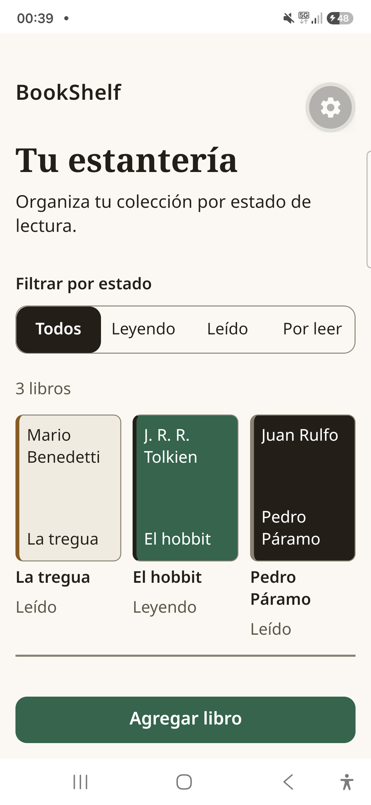
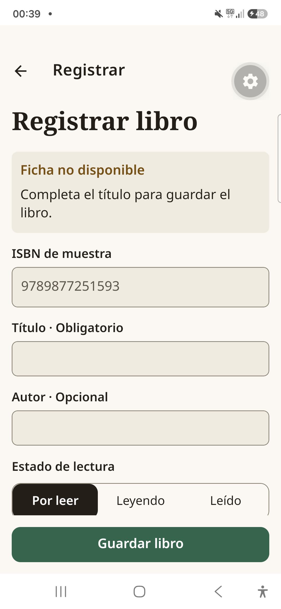
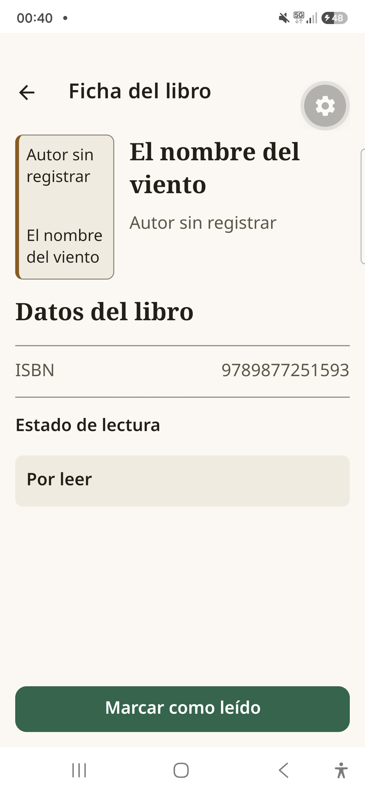

# BookShelf · Avance 1

Aplicación Android para organizar un catálogo personal de libros y seguir su
estado de lectura.

## Ejecutar en Android

Se requiere Node.js 22 (22.13 o posterior), npm y [Expo Go para SDK 58](https://expo.dev/go?sdkVersion=58&platform=android&device=true) en el teléfono.

Después de clonar el repositorio, ejecuta desde su raíz:

```bash
npm ci
npx expo start
```

Conecta la computadora y el teléfono a la misma red y escanea el código QR desde Expo Go. Verás «Tu estantería». Los datos son de ejemplo y viven en memoria: se conservan al navegar y se reinician al recargar la app.

## Recorrido de la demo

1. En **Tu estantería**, toca **Agregar libro**. Intenta guardar sin título: el formulario muestra el error sin salir.
2. Escribe **Doctor Sueño**, selecciona el estado **Por leer** y guarda el libro. Aparecerá en Biblioteca.
3. Toca su tarjeta para abrir la ficha. Selecciona **Marcar como leído** y luego **Ver en la biblioteca**. El libro aparecerá con el filtro **Leído** activo.

El ISBN de Registro es de muestra. Esta entrega no usa cámara, backend ni almacenamiento persistente.

## Capturas de Android

| Biblioteca | Registro | Ficha |
|---|---|---|
|  |  |  |

## Comprobar los cambios

```bash
npm run typecheck
```
