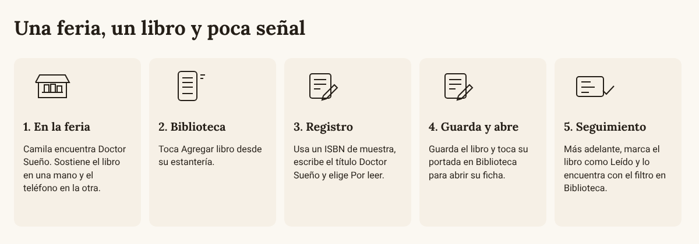
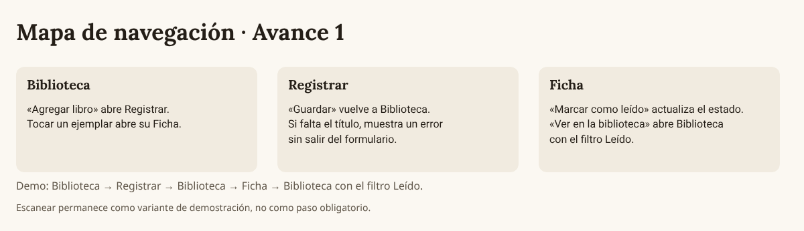
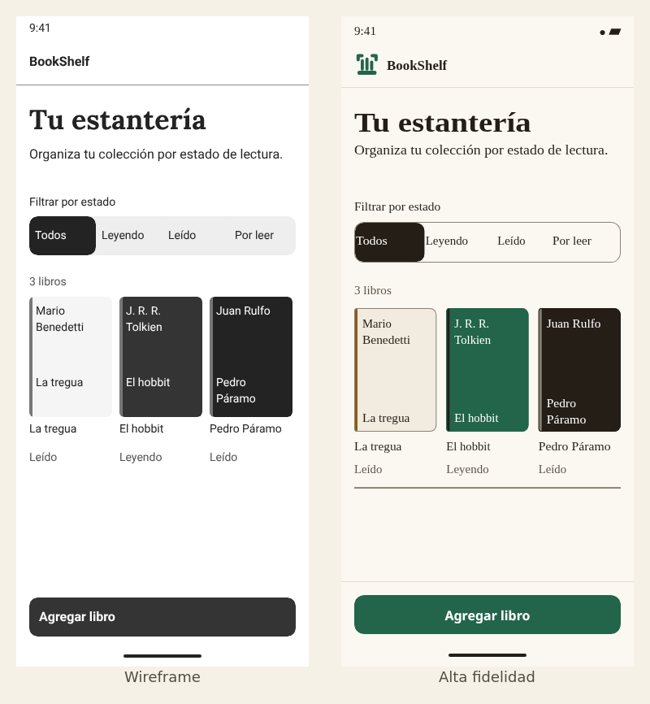
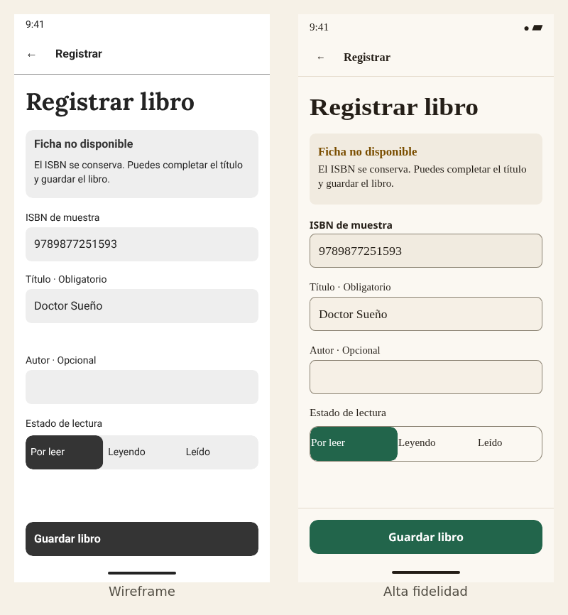
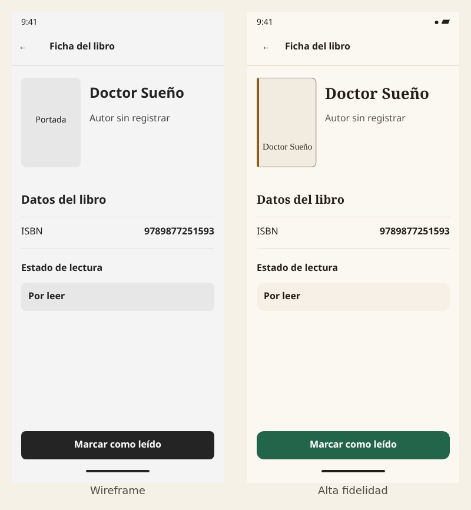
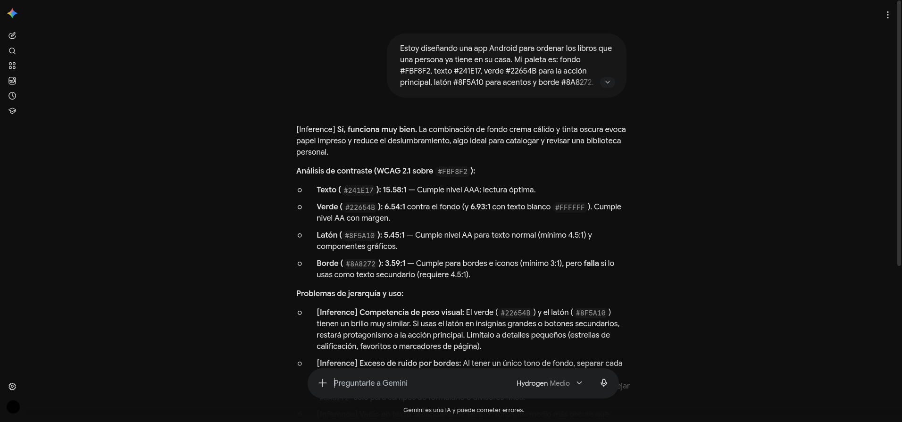
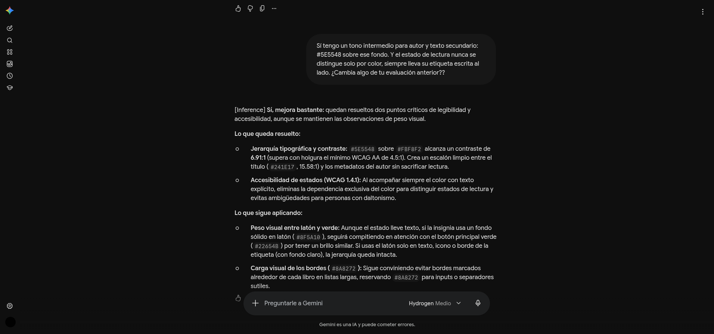
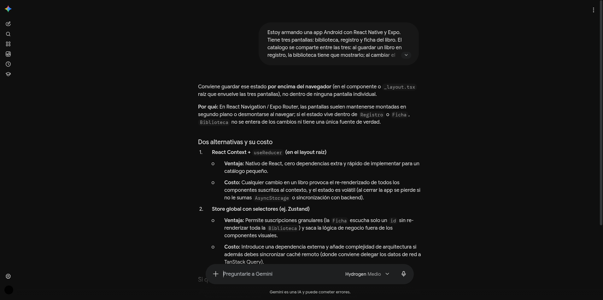
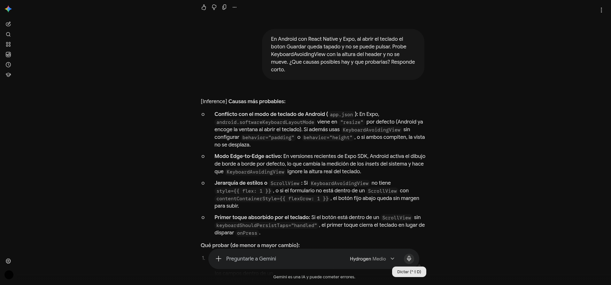

# Bitácora de Diseño y Frontend Móvil — BookShelf

Avance N°1 · Tecnologías Web y Móviles · Ingeniería Civil en Informática

BookShelf es una aplicación Android para ordenar los libros que una persona ya
tiene en su casa. Nació de un problema concreto: saber qué libros hay en el
estante, cuáles se están leyendo y cuáles quedaron pendientes, sin tener que
revisar el estante físico ni repetir el registro de un libro que ya se posee.
El código de barras es el medio previsto para incorporar un libro rápido; la
identidad del producto —tener el catálogo propio a mano— aparece antes que el
escáner.

Este avance entrega el diseño completo en Penpot y tres interfaces funcionales
en React Native con Expo SDK 58: **Biblioteca**, **Registrar libro** y
**Ficha del libro**. El recorrido demostrable es:

> Biblioteca → Registrar libro → Biblioteca → Ficha del libro → Biblioteca filtrada en Leído

Datos de ejemplo (`mock`) y estado en memoria: el avance no incluye backend,
cámara ni persistencia entre reinicios de la aplicación.

**Enlaces de la entrega**

- Repositorio: <https://github.com/PeepoClown04/bookShelf-movil>
- Diseño en Penpot: <https://design.penpot.app/?screen=viewer&file-id=7b7d55f9-965b-8000-8008-f7168f298bbb&page-id=7b7d55f9-965b-8000-8008-f7168f298bbc&section=interactions&index=0&share-id=b36fccfd-1f1c-4a11-bae5-d9d4867a0f07>

---

## 1. Identidad de marca y UI Kit base

### Nombre y propósito

**BookShelf** nombra directamente lo que la aplicación administra: el estante
propio. No es un nombre metafórico ni un juego de palabras; la persona que lo
lee entiende que ahí se guardan libros.

### Logo e ícono

| Pieza | Archivo | Uso |
|---|---|---|
| Logo vectorial | [`img/logo-bookshelf.svg`](img/logo-bookshelf.svg) | Cabecera y material de presentación |
| Ícono de aplicación | [`img/icono-bookshelf.svg`](img/icono-bookshelf.svg) · [`img/icono-bookshelf.png`](img/icono-bookshelf.png) | Ícono de la app en Android (1024 × 1024) |
| Pantalla de carga | [`img/splash-bookshelf.svg`](img/splash-bookshelf.svg) | Splash de inicio |

El logo se dibujó como vector, no como imagen exportada: se lee a 48 px, no
tiene artefactos de compresión y puede escalarse al tamaño de ícono sin pérdida.

### Paleta

Los colores son obligatorios en Penpot como estilos y en el código como
constantes en `src/constants/theme.ts`. Ningún componente escribe un color
literal.

| Rol | HEX | Uso | Justificación |
|---|---|---|---|
| Papel (primario claro) | `#FBF8F2` | Fondo de pantalla | Evoca papel de libro sin llegar al blanco puro, que cansa en lectura prolongada |
| Tinta | `#241E17` | Texto principal | Contraste alto sobre papel (15,56:1); más suave que el negro absoluto |
| Verde biblioteca (primario) | `#22654B` | Acción principal y estados activos | Verde de lomo de libro encuadernado; identifica la acción sin competir con el texto |
| Latón (secundario) | `#8F5A10` | Etiquetas y acentos | Acento cálido de los herrajes de una biblioteca; se aparta del verde para no confundir jerarquías |
| Superficie | `#F1EBE0` | Tarjetas y bloques | Separa contenido del fondo sin recurrir a sombras |
| Texto secundario | `#5E5548` | Autor, ISBN, ayudas | Marrón apagado, mantiene 6,91:1 sobre papel |
| Borde | `#8A8272` | Separadores y contornos | Límite visible a 3,59:1, suficiente para elementos gráficos |
| Peligro | `#97281B` | Error de validación | Rojo oscuro legible (7,52:1) |
| Advertencia | `#7A4E00` | Avisos | |
| Éxito | `#15603E` | Confirmaciones | |
| Blanco | `#FFFFFF` | Texto sobre color | 6,93:1 sobre verde, 5,77:1 sobre latón |

Contrastes calculados con la fórmula WCAG 2.1 sobre las combinaciones usadas en
pantalla. Todos los textos superan 4,5:1; el borde es el único valor entre 3:1 y
4,5:1 y se emplea solo como elemento gráfico, nunca como texto.

### Tipografía

| Nivel | Fuente | Tamaño | Uso |
|---|---|---|---|
| Título de pantalla | Noto Serif Bold | 34 | Biblioteca, Registrar, Ficha |
| Encabezado de sección | Noto Serif Bold | 24 | Título de un libro en la ficha |
| Cuerpo | Noto Sans Regular | 16 | Todo texto de lectura y campos |
| Etiqueta | Noto Sans SemiBold | 14 | Botones y etiquetas de campo |

La serif aporta el tono editorial del producto; la sans mantiene legible la
interfaz y los formularios. El cuerpo nunca baja de 16, que es el mínimo cómodo
en un teléfono y el que fija la rúbrica.

---

## 2. Arquitectura y flujo de usuario

### Storyboard de cinco viñetas

El caso de uso principal es incorporar un libro al estante propio y seguir su
lectura. El storyboard lo cuenta con Camila, de pie en una feria del libro, con
el teléfono en una mano y el libro en la otra: el escenario real donde la app se
usa, con una sola mano y sin señal garantizada.

| Viñeta | Situación | Qué resuelve la app |
|---|---|---|
| 1. En la feria | Camila encuentra *Doctor Sueño*. Sostiene el libro en una mano y el teléfono en la otra | El registro tiene que ser rápido y con una sola mano |
| 2. Biblioteca | Toca «Agregar libro» desde su estantería | El alta está siempre en el mismo lugar, al alcance del pulgar |
| 3. Registro | Usa un ISBN de muestra, escribe el título y elige «Por leer» | Solo dos datos obligatorios: no frena el registro |
| 4. Guarda y abre | Guarda y toca la portada en Biblioteca para abrir la ficha | El libro guardado aparece de inmediato en la lista |
| 5. Seguimiento | Más adelante lo marca como «Leído» y lo encuentra con el filtro | El estado cambia y el libro se ve en su nuevo filtro |

### Mapa de navegación

El mapa separa tres recorridos: el alta (Biblioteca → Registrar → Biblioteca), la
consulta de un ejemplar (Biblioteca → Ficha) y el seguimiento (Ficha → Biblioteca
filtrada en «Leído»). Escanear queda como variante de demostración, no como paso
obligatorio.

La navegación del código replica el mapa con un `Stack` de Expo Router:

| Archivo | Pantalla |
|---|---|
| `src/app/_layout.tsx` | Envuelve el stack en `KeyboardProvider` y `CatalogProvider` |
| `src/app/index.tsx` | Biblioteca |
| `src/app/registrar.tsx` | Registrar libro |
| `src/app/libros/[id].tsx` | Ficha del libro (ruta dinámica por ID) |

El regreso usa `router.dismissTo('/')` en lugar de apilar pantallas: después de
guardar o de ver un libro, la persona vuelve a la Biblioteca y no a un historial
de formularios.

---

## 3. Evolución visual

Los wireframes son de baja fidelidad, en escala de grises y en marcos de
360 × 800 dp; los mockups son el mismo recorrido en alta fidelidad, con la paleta
y la tipografía definitivas. La comparación va lado a lado, pantalla por pantalla.

Lo que cambió entre ambos niveles, y por qué:

- **Jerarquía.** En el wireframe el foco era el título del libro; en el mockup la
  portada y el título comparten el primer plano y el estado de lectura baja a una
  etiqueta, porque la decisión de la persona es «¿qué libro abro?», no «¿qué
  estado tiene?».
- **Zonas de alcance.** La acción principal bajó al tercio inferior, al alcance
  del pulgar, con 328 × 48 en el prototipo y `touchTarget = 48` en el código.
- **Densidad.** El wireframe reservaba una fila por dato; el mockup agrupó autor
  e ISBN en la ficha y dejó la tarjeta con lo mínimo para reconocer el libro.
- **Color con significado.** El wireframe no distingue estados; el mockup usa el
  verde para la acción y el latón para el lomo de la portada, sin depender del
  color para comunicar el estado de lectura.

---

## 4. Evidencia del frontend

Capturas tomadas en el teléfono físico (Android, Expo Go, SDK 58), no en un
emulador ni en el editor:

| Pantalla | Captura |
|---|---|
| Biblioteca con filtros | [`img/biblioteca.png`](img/biblioteca.png) |
| Registrar libro | [`img/registrar.png`](img/registrar.png) |
| Ficha del libro | [`img/ficha.png`](img/ficha.png) |

La demostración en el teléfono se realiza durante la defensa, incluido el
cambio de estado y el regreso a la Biblioteca filtrada.

### Qué funciona hoy en cada pantalla

| Pantalla | Acciones reales |
|---|---|
| Biblioteca | Lista el catálogo con `FlatList`, filtra por los cuatro estados y abre la ficha de un libro |
| Registrar libro | Valida el título obligatorio, muestra el error en el campo, guarda el libro y vuelve a Biblioteca con el filtro «Todos» |
| Ficha del libro | Recibe el ID por la ruta, muestra los datos del libro, cambia su estado a leído y vuelve a Biblioteca filtrada en «Leído» |

No forman parte de este avance: escanear el código de barras, la conexión con un
backend, la cuenta de usuario y el guardado entre reinicios.

---

## 5. Justificación técnica y ergonómica

**Una decisión por pantalla.** Biblioteca responde «¿qué tengo?», Registrar
responde «¿qué agrego?» y la Ficha responde «¿qué sé de este libro?». Ninguna
pantalla intenta hacer las tres cosas, y por eso cada una cabe en una lectura
sin desplazamiento en un teléfono de 6 pulgadas.

**Jerarquía visual antes que color.** La portada y el título usan el mayor
contraste y tamaño; el estado se distingue por texto («Leyendo», «Leído», «Por
leer»), no solo por color. Esto importa porque una persona con daltonismo
necesita leer el estado, y porque el color solo no comunica estado en un
formulario.

**Tamaño táctil.** Toda acción mide 48 dp de alto como mínimo
(`touchTarget = 48`), el botón principal ocupa el ancho útil de la pantalla y se
ubica en la zona inferior. Los filtros segmentados tienen 48 px de alto y el
área táctil cubre la etiqueta completa, no solo el texto.

**Teclado.** Registrar usa un contenedor que desplaza el contenido cuando el
teclado aparece. Sin él, el botón «Guardar libro» quedaba debajo del teclado en
Android y el formulario era intransitable. Fue el defecto más serio detectado en
dispositivo y se corrigió con `react-native-keyboard-controller`.

**Zonas seguras.** Las tres pantallas respetan los insets del sistema: el
contenido no queda bajo el notch ni bajo la barra de gestos.

**Carga cognitiva.** El formulario pide solo dos datos obligatorios —título y
estado— y precarga el ISBN de muestra. Un autor ausente no impide guardar: la
ficha se marca como incompleta en lugar de bloquear el registro.

**Estado y confianza.** Al marcar un libro como leído, la aplicación cambia el
filtro a «Leído» antes de volver. Sin eso, el libro desaparecería de la vista
anterior y parecería borrado. La interfaz muestra el resultado de la acción en
lugar de dejar que la persona lo deduzca.

---

## 6. Bitácora de IA generativa

Durante el avance usé **Gemini en su chat web** para tres consultas puntuales:
revisar la paleta, decidir dónde vive la validación del título y diagnosticar un
problema de teclado en Android. Cada consulta partió de una decisión concreta del
proyecto y terminó en el teléfono, no en el chat. Este apartado registra qué le
pedí, qué respondió, qué tenía de equivocado y qué hice finalmente.

### 6.1. Herramienta utilizada

| Herramienta | Forma de uso | Para qué se usó |
|---|---|---|
| Gemini | Chat web (gemini.google.com) | Revisar la paleta y el contraste, decidir dónde vive el estado compartido del catálogo y diagnosticar el teclado que tapaba el botón Guardar |

### 6.2. Forma de trabajo

La IA propuso y yo decidí. Se usaron dos formas de trabajo:

- **Para revisar una decisión ya tomada:** le entregué la paleta y los valores
  reales, y le pedí que señalara problemas de contraste o de jerarquía. Acepté lo
  que pude comprobar y descarté lo que no correspondía al proyecto.
- **Para diagnosticar un defecto:** le describí el síntoma, la plataforma y lo que
  ya había probado, y le pedí causas posibles. Después probé cada hipótesis en el
  dispositivo.

Cada respuesta pasó por estos pasos antes de quedar en el proyecto:

1. Darle contexto concreto: los valores HEX, el archivo o el síntoma exacto.
2. Leer la respuesta completa y no copiar el código tal como venía.
3. Comprobar el resultado con TypeScript, las pruebas y el teléfono.
4. Registrar qué se aceptó y qué se descartó, y por qué.

### 6.3. Casos

#### Caso 1. Revisión de la paleta y del contraste

**Qué le pedí:**

> «Estoy diseñando una app Android para ordenar los libros que una persona ya tiene en su casa. Mi paleta es: fondo #FBF8F2, texto #241E17, verde #22654B para la acción principal, latón #8F5A10 para acentos y borde #8A8272. ¿Funciona para una app de lectura? ¿Qué problemas de contraste o de jerarquía ves? Sé breve.»

**Qué respondió:** que la paleta funciona porque el fondo cálido evoca papel y
reduce el deslumbramiento. Calculó los contrastes: texto 15,58:1, verde 6,54:1
sobre el fondo y 6,93:1 con texto blanco, latón 5,45:1, borde 3,59:1. Advirtió
que el borde no sirve como texto y que el latón y el verde tienen brillo
parecido, así que compiten por atención.

**Qué tenía de equivocado:** supuso que faltaba un tono intermedio para el autor y
el texto secundario, y que el estado de lectura se distinguía solo por color.
Ninguna de las dos cosas era cierta: el proyecto usa `#5E5548` (6,91:1) para
texto secundario y el estado siempre lleva su etiqueta escrita.

**Qué corregí en la consulta:** se lo dije y volvió a evaluar. Reconoció que los
dos puntos quedaban resueltos y mantuvo solo dos observaciones: el peso de una
insignia de latón frente al botón verde, y los bordes marcados en listas largas.

**Qué quedó en el proyecto:** el latón se usa solo en etiquetas pequeñas y en el
número de ejemplares, nunca en una acción; el borde se reserva para separadores e
inputs, no para rodear cada tarjeta de la lista.

#### Caso 2. Dónde vive el estado del catálogo

**Qué le pedí:**

> «Estoy armando una app Android con React Native y Expo. Tiene tres pantallas: biblioteca, registro y ficha del libro. El catalogo se comparte entre las tres: al guardar un libro en registro, la biblioteca tiene que mostrarlo; al cambiar el estado en la ficha, la biblioteca tiene que verlo. ¿Donde conviene guardar ese estado y por que? Dame dos alternativas y su costo. Responde corto.»

**Qué respondió:** que el estado vaya por encima del navegador, en el layout raíz
que envuelve las tres pantallas, porque las pantallas se desmontan al navegar. Dio
dos alternativas con su costo: **Context con `useReducer`**, nativo y sin
dependencias, pero cualquier cambio vuelve a renderizar todo lo suscrito y el
estado es volátil; y un **store global con selectores**, por ejemplo Zustand, con
suscripciones granulares, a cambio de una dependencia externa y más arquitectura
cuando haya que sincronizar con un servidor.

**Qué acepté:** la ubicación. `CatalogProvider` envuelve el stack en
`src/app/_layout.tsx`, y las tres pantallas leen el mismo catálogo con
`useCatalog()`.

**Qué ajusté:** no usé `useReducer` ni Zustand. Con cuatro operaciones y un
catálogo de tres libros de ejemplo, `useState` alcanza; el costo que señaló
—volver a renderizar todo lo suscrito— es real pero irrelevante a esta escala.
Zustand tendría sentido cuando el catálogo crezca o se sincronice, y en ese
momento entrará también TanStack Query para los datos de red.

**Qué quedó en el proyecto:** guardar en Registro y cambiar el estado en la Ficha
se ven en Biblioteca sin pasar libros completos por la ruta. La pantalla de la
Ficha recibe solo el `id` y busca el libro en el catálogo compartido.

#### Caso 3. El teclado tapaba el botón Guardar

**Qué le pedí:**

> «En Android con React Native y Expo, al abrir el teclado el boton Guardar queda tapado y no se puede pulsar. Probe KeyboardAvoidingView con la altura del header y no se mueve. ¿Que causas posibles hay y que probarias? Responde corto.»

**Qué respondió:** cuatro causas posibles. Primero, el modo de teclado de Android:
`softwareKeyboardLayoutMode` viene en `resize` y, combinado con un
`KeyboardAvoidingView` mal configurado, la vista no se desplaza. Segundo, el modo
Edge-to-Edge de los SDK recientes, que cambia la medición de los insets. Tercero,
la jerarquía de estilos: sin `flex: 1` o fuera de un `ScrollView` con
`flexGrow: 1`, el botón no tiene margen para subir. Cuarto, un `ScrollView` sin
`keyboardShouldPersistTaps="handled"`, donde el primer toque solo cierra el
teclado.

**Qué verifiqué:** el diagnóstico era correcto en lo esencial. En el teléfono el
botón quedaba en y=2092, debajo del teclado, y el `KeyboardAvoidingView` estándar
no lo movía en Android API 36.

**Qué quedó en el proyecto:** se reemplazó el contenedor por
`react-native-keyboard-controller`, que mide el teclado real en lugar de estimarlo.
El botón pasó a y=1219 y se pudo pulsar con el teclado abierto.

### 6.4. Lecciones sobre el uso de la IA

- **La IA acierta el diagnóstico y se equivoca en el alcance.** Las tres causas del
  teclado eran plausibles; las dos alternativas de estado eran correctas, pero la
  decisión de no agregar dependencias era mía. Sirve para enumerar posibilidades,
  no para decidir qué entra al proyecto.
- **Sin contexto real, inventa.** Al no conocer `#5E5548`, concluyó que faltaba un
  tono intermedio. Con el dato exacto, corrigió su evaluación.
- **La verificación no se delega.** El teclado solo se confirmó con el teléfono en
  la mano: en el editor y en el chat el formulario parecía correcto.
